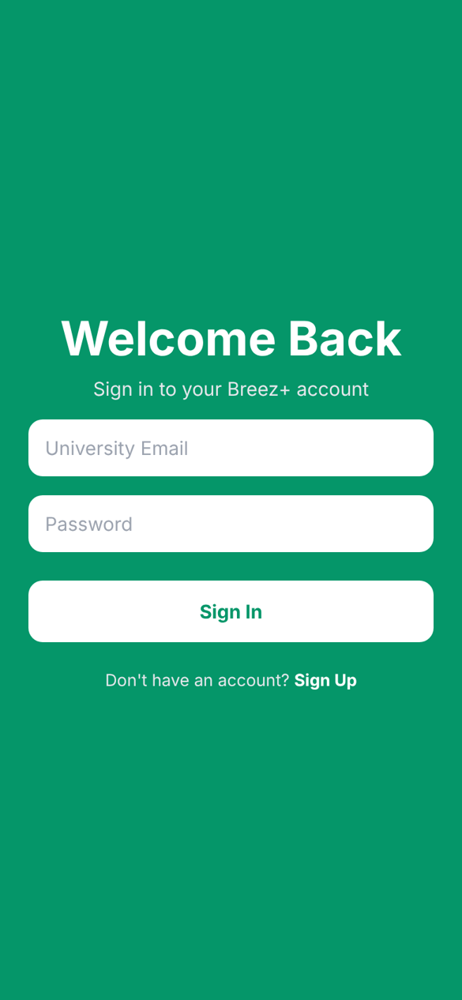
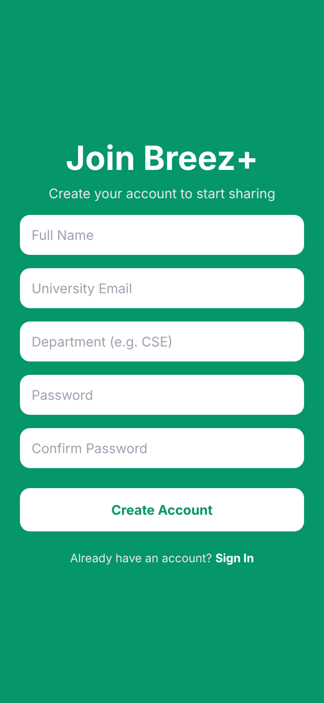

# Breez+

**A study-material sharing app for university students: share your notes, earn coins, spend them on other people's notes.**

Built with React Native (Expo), TypeScript and Supabase. Only students with an `@eastdelta.edu.bd` email can join.

> 🚧 **Status: in active development.** Authentication and user profiles are complete; resource sharing is next. See the [roadmap](#roadmap).

<p align="center">
  
  
  
  
</p>

## The idea

At my university, notes, slides and past papers are scattered across group chats and lost every semester. Breez+ gives them one home, and a small coin economy keeps it fair: you earn coins by uploading and spend them by downloading, so people share instead of only taking.

## Features

**Done**

- Sign up and sign in with email and password (Supabase Auth)
- University-only access: `@eastdelta.edu.bd` is checked in the app **and** in the database
- A profile is created automatically on sign-up (name, department, 50 starting coins)
- Users stay signed in after closing the app; signed-in and signed-out screens are protected routes
- Form validation with clear error messages; works on iOS, Android and web

**Planned**

- Upload PDFs, slides and images (+5 coins)
- Browse, search and filter by course code and semester
- Download resources (−3 coins), handled in a single database transaction
- Ratings, badges, notifications and a weekly leaderboard
- AI-generated summaries of uploaded PDFs

## Tech stack

| Area | Technology |
| --- | --- |
| App | React Native, Expo SDK 58, Expo Router (file-based navigation) |
| Language | TypeScript |
| Backend | Supabase: PostgreSQL, Auth, Row Level Security |
| Quality | ESLint, TypeScript strict mode |

## How sign-up works

1. The app validates the form, then calls `supabase.auth.signUp()` with the user's name and department as metadata.
2. Supabase Auth creates the account and (if enabled) sends a confirmation email.
3. A PostgreSQL trigger, `handle_new_user`, runs on the new `auth.users` row: it rejects any email outside `@eastdelta.edu.bd`, then inserts the matching row into `public.profiles`.
4. The app listens for auth changes in a React context. When a session appears, the protected routes in `src/app/_layout.tsx` move the user to the home screen; when it disappears, back to the welcome screen.

## Security decisions

- **Row Level Security** on `profiles`: a user can read and update only their own row.
- **Column-level permissions**: users may update only `full_name` and `department`. Coins can never be changed from the app, only by trusted database functions.
- **No insert policy**: profiles are created only by the `security definer` trigger, never by the client.
- **Server-side domain check**: the app's email check can be bypassed, so the database enforces it too.
- **Keys**: the app ships only the Supabase *publishable* key. The `.env` file is git-ignored.

## The story behind this version

The first version of Breez was generated with an AI app builder. It looked finished, but when I tested it against a real Supabase project, I found that:

- sign-up never created a profile, because the `profiles` table had no insert policy (the app showed "Welcome, undefined" and the API returned `406`);
- any user could set their own coin balance to any number, because the update policy covered every column;
- notifications, badges and ratings silently failed, because their database functions ran with the caller's permissions and were blocked by RLS.

Instead of patching code I didn't understand, I started over and am rebuilding Breez+ one feature at a time, with the database designed by hand. The old version is kept at [badhan7700/Breez](https://github.com/badhan7700/Breez) for comparison.

## Getting started

**Requirements:** Node.js 22.13+ (or 24.3+), a free [Supabase](https://supabase.com) project, and the [Expo Go](https://expo.dev/go) app on your phone.

```bash
git clone https://github.com/badhan7700/breez-plus.git
cd breez-plus
npm install
```

1. In Supabase, open **SQL Editor** and run [`supabase/migrations/20261107000000_profiles.sql`](supabase/migrations/20261107000000_profiles.sql).
2. Copy `.env.example` to `.env` and fill in your project URL and publishable key.
3. Start the app and scan the QR code with Expo Go (or press `w` for the web):

```bash
npx expo start
```

Other commands: `npm run lint`, `npm run typecheck`.

## Project structure

```
src/
├── app/              Screens (each file is a route)
│   ├── _layout.tsx   Navigation + protected routes
│   ├── index.tsx     Welcome
│   ├── login.tsx
│   ├── register.tsx
│   └── home.tsx      Signed-in home
├── components/       Reusable UI: AppButton, AppInput, AuthLayout, AuthFooter
├── context/          AuthContext: who is signed in
├── lib/              Supabase client
├── constants/        Colours
├── types/            TypeScript types for database rows
└── utils/            Validation and alert helpers
supabase/migrations/  Database schema, RLS policies and triggers
```

## Roadmap

| Phase | Scope | Status |
| --- | --- | --- |
| 1 | Screens, navigation, shared components | ✅ Done |
| 2 | Supabase auth, profiles, RLS | ✅ Done |
| 3 | Upload resources (Supabase Storage) | ⏳ Next |
| 4 | Browse, search, download, coin transactions | Planned |
| 5 | Ratings, badges, notifications, profile page | Planned |
| 6 | Course codes, leaderboard, AI summaries | Planned |

## Author

**Badhan** · [github.com/badhan7700](https://github.com/badhan7700)
